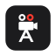
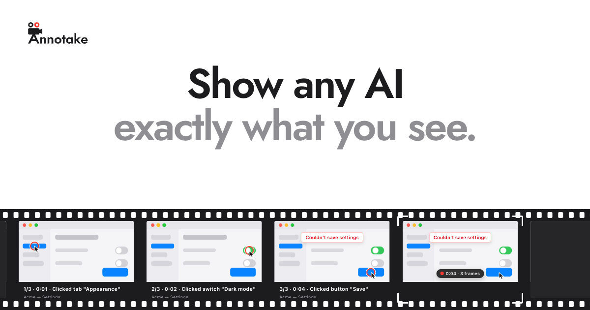

<p align="center">
  
</p>

<h1 align="center">Annotake</h1>

<p align="center">
  <strong>Show any AI exactly what you see.</strong>
</p>

<p align="center">
  A Mac menu-bar app. Press a key, click through anything on your screen, and drag the card into
  ChatGPT, Claude, or Cursor. Each step comes out as a screenshot, captioned with what you clicked.
</p>

<p align="center">
  <a href="https://annotake.app"><strong>Website</strong></a> ·
  <a href="#install"><strong>Install</strong></a> ·
  <a href="#using-it"><strong>Using it</strong></a> ·
  <a href="#what-you-get"><strong>What you get</strong></a> ·
  <a href="#privacy"><strong>Privacy</strong></a> ·
  <a href="#build-from-source"><strong>Build from source</strong></a>
</p>

<p align="center">
  <a href="LICENSE"></a>
  
  <a href="https://github.com/fayzan123/annotake-releases/releases/latest"></a>
</p>

<p align="center">
  
</p>

A screen recording is a video most AI can't watch, and a single screenshot misses everything around it.
Annotake keeps only the frames where something changed, captions each with the button, tab, or field you
used, and hands your AI the steps as images it can read in one go: a bug to reproduce, a long document to
page through, a console full of errors, a flow you want explained.

## Install

Free during the beta. Needs macOS 15 or later, on Apple silicon or Intel.

**[Download Annotake.dmg](https://annotake.app/download)**, open it, and drag Annotake to Applications.

Or in Terminal:

```bash
curl -fsSL https://raw.githubusercontent.com/fayzan123/annotake-releases/main/install.sh | sh
```

Annotake is signed and notarized by Apple, and updates itself with [Sparkle](https://sparkle-project.org).
Its first run walks you through three permissions, one at a time:

<details>
<summary><strong>Why it asks for each permission</strong></summary>

- **Accessibility**, so it can name the buttons you click, and keep your trigger key out of your clicks while you hold it.
- **Input Monitoring**, so it can notice your trigger key, and your clicks and keys while you record. It never records what you type.
- **Screen Recording**, so it can capture your screen while you record.

macOS turns on the last two only after Annotake reopens, so the first run reopens it for you.

</details>

## Using it

Right ⌘ out of the box. Settings can switch it to Right ⌥ or fn.

1. **Double-tap Right ⌘.** A pill at the bottom of the screen shows you're recording.
2. **Click through it** in any app. Annotake keeps its own windows out of the recording.
3. **Double-tap Right ⌘ again.** A card appears at the bottom right.
4. **Drag the card** into ChatGPT, Claude, Cursor, or anything else that takes images.

For something quick, **hold Right ⌘**, click, and let go. **Right ⌘ + Esc** cancels.
Click the card to review it first: ← → flips through the frames, ⌫ removes one, and Return applies.

## What you get

Each recording is a folder of PNGs and a `steps.md` in `~/Pictures/Annotake`:

```
~/Pictures/Annotake/2026-10-01 at 09.41.12/
├── 01_0m01s.png
├── 02_0m02s.png
├── 03_0m04s.png
└── steps.md
```

```markdown
# Annotake capture — 2026-10-01 at 09.41.12
Screen: Built-in Retina Display · 0:04 · 3 frames (from 3 candidates)

1. 0:01 · Acme — Settings · Clicked tab "Appearance"
2. 0:02 · Acme — Settings · Clicked switch "Dark mode"
3. 0:04 · Acme — Settings · Clicked button "Save"
```

Recordings clear out after 30 days unless you choose to keep them.

## Privacy

Nothing you record leaves your Mac.

- **No AI.** Frames are picked by comparing pixels, and captions come from macOS Accessibility. No models, no uploads.
- **Only while you record.** Annotake sees your screen only while you record, and never records what you type.
- **Two network calls.** A daily update check against GitHub, and, if you give it one, your email address, once, for
  security notices. The email is optional.

The full policy is at [annotake.app/privacy](https://annotake.app/privacy).

## Build from source

Needs macOS 15 or later and Swift 6: Xcode, or just the Command Line Tools (`xcode-select --install`).

```bash
git clone https://github.com/fayzan123/annotake.git
cd annotake
make cert   # once: a local signing identity, so macOS remembers the permissions across builds
make run    # builds a universal Annotake.app into build/ and opens it
```

Quit the downloaded Annotake first: both use the same bundle id. `make test` runs the app's tests.

<details>
<summary><strong>What's where</strong></summary>

| Path | What it is |
|---|---|
| `Sources/AnnotakeCore` | The engine: gestures, picking frames, captions, and `steps.md` |
| `Sources/AnnotakeCapture` | Screen capture, with ScreenCaptureKit |
| `Sources/AnnotakeInput` | The trigger key, clicks, and keys |
| `Sources/AnnotakeExport` | Writing the frames and the folder |
| `Sources/AnnotakeApp` | The menu-bar app: pill, cards, review, Settings, and the first run |
| `Sources/annotake-replay` | Replays a saved session through the frame picker, for tuning |
| `site/` | annotake.app: plain HTML, CSS, and JavaScript, plus Vercel functions. `make site-dev` serves it, `make site-test` tests it |

</details>

## License

Annotake's code is under the [GNU General Public License, version 3](LICENSE): use it, study it, change it,
and share it under the same license. The license covers the code, not the Annotake name or logo: if you
share a changed version, give it its own name and logo.

Annotake bundles [Sparkle](site/licenses/sparkle.txt) (MIT), and the website is set in
[Jost](site/licenses/jost-ofl.txt) (SIL Open Font License).
